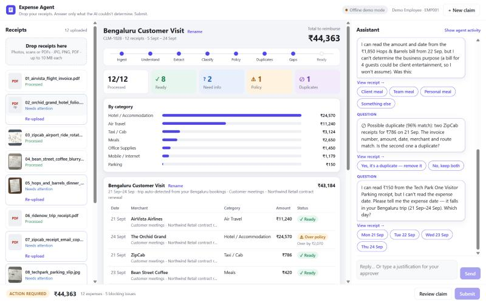
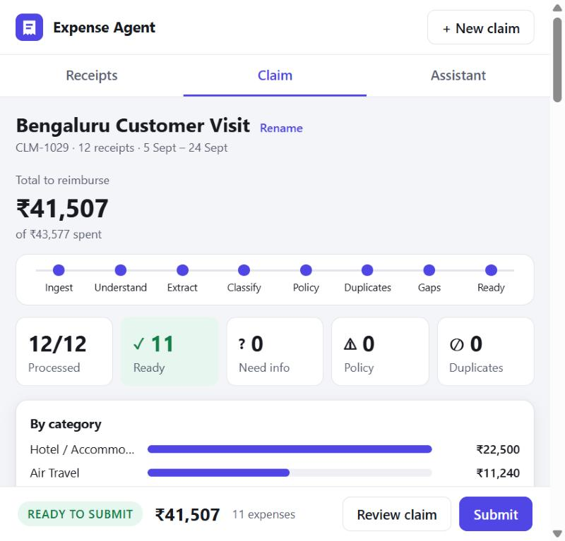
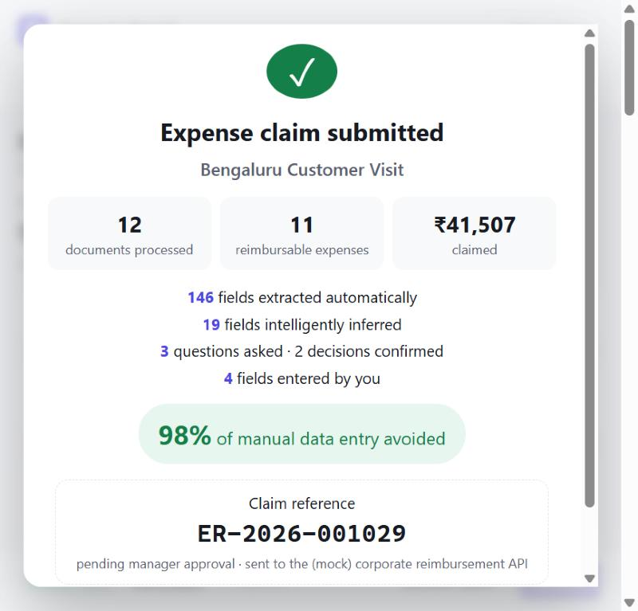

# Expense & Reimbursement Agent

> **Drop your receipts. Answer only what the AI couldn't determine. Submit.**

**Track:** AI Innovation Lab Season 2 — business case: Expense & Reimbursement Agent

| | |
|---|---|
| ▶️ **Demo video (4 min)** | https://www.youtube.com/watch?v=8ON3TWi6uOk |
| 🌐 **Hosted app** | https://exp-reimb-agent.onrender.com |
| 📐 **Technical design** | [docs/DESIGN.md](docs/DESIGN.md) |

> **About the hosted app:** the **12 bundled sample receipts** always replay recorded document extractions (matched by file hash), so the guided demo is deterministic and costs nothing to run. **Receipts you upload yourself** (photos, scans and PDFs) are read live by **OpenAI (`gpt-5.4-mini`)**, using the same structured-extraction schema, validation and confidence checks as the Claude path. Everything after extraction is the real application: classification, inference, policy checks, duplicate detection, clarification questions, revalidation and mock submission. Free-text chat replies are handled by the deterministic interpreter. Claude tool use for chat, and Claude extraction, need an `ANTHROPIC_API_KEY` and are not switched on for the public instance (see [docs/DEPLOYMENT.md](docs/DEPLOYMENT.md)). Please upload only fictional or non-sensitive receipts to the public app. The demo video was recorded in offline mode.

An AI-native expense assistant. It turns a pile of unstructured receipts (photos, scans, PDFs) into a validated, policy-checked reimbursement claim. The employee does as little work as possible.



## Hosted demo

**https://exp-reimb-agent.onrender.com** is a single free Render Web Service built from the included `Dockerfile` and `render.yaml`. Click **Use the 12 demo receipts** and follow the [demo scenario](#9-demo-scenario-about-2-minutes).

* **First visit:** the free instance sleeps after 15 minutes idle and takes about a minute to wake up.
* **AI reading:** the bundled demo receipts replay recorded extractions; your own uploads are read by OpenAI (see the note above).
* **Data:** demo claims are temporary and reset whenever the service restarts or redeploys. Please use only the bundled fictional receipts.
* **Verify it yourself:** `python scripts/verify_deployment.py https://exp-reimb-agent.onrender.com` runs the whole 12-receipt demo end to end through the public API, using only the Python standard library.

To deploy your own copy:

[](https://render.com/deploy?repo=https://github.com/pandeyop/exp-reimb-agent)

Setup steps, environment variables (including how to switch on live Claude extraction with a server-side key), free-tier limits and verification are in **[docs/DEPLOYMENT.md](docs/DEPLOYMENT.md)**.

---

## 1. Problem

Expense claims are mostly data entry: retyping merchant, date, amount and GST from receipts into a 20-field form, then reading the policy to work out what will be rejected. Employees hate it. Finance teams then reject claims for missing purposes, over-limit hotels and duplicate receipts.

## 2. Solution overview

The employee drops all their documents at once. The agent then:

1. **Reads every document**: multi-page PDFs, rotated and blurry photos, app screenshots.
2. **Extracts** more than 25 fields, each with a confidence score (merchant, GSTIN, totals, taxes, routes, nights, covers and more).
3. **Classifies** each expense into a policy category and explains why.
4. **Infers** what it reasonably can. It reads the trip purpose from the flight booking and applies it to the other trip expenses, and it groups the expenses into a trip.
5. **Checks policy** from a JSON config: daily/nightly/monthly limits, required fields, stale and future dates.
6. **Detects duplicates** across the claim and against previously reimbursed expenses.
7. **Asks only what's missing**, in a chat, with consolidated questions and one-tap answers.
8. **Revalidates** after every answer or edit. The claim moves to **READY TO SUBMIT** on its own.
9. **Submits** to a mocked corporate reimbursement API, but only when the employee explicitly confirms.

In the bundled demo, 12 documents produce 146 extracted fields and 19 inferred fields. The employee answers 3 questions and confirms 1 duplicate, so **98% of manual data entry is avoided**.

## 3. How it works

```
INGEST → UNDERSTAND → EXTRACT → NORMALISE → CLASSIFY → INFER/GROUP → CHECK POLICY
      → CHECK DUPLICATES → IDENTIFY GAPS → ASK MINIMAL QUESTIONS → UPDATE → REVALIDATE → READY
```

* **Frontend:** React + Vite. Three panes (receipts, claim dashboard, assistant chat), an expense drawer with the original receipt beside its editable fields, and a review & submit flow. The production build is served by FastAPI.
* **Backend:** FastAPI + SQLite. Agent capabilities live in separate modules under `backend/app/agent/`: document interpreter, normaliser, classifier, inference & grouping, policy evaluator, duplicate detector, clarification planner, claim manager, chat agent and submission tool.
* **AI:** Claude reads each document into a strict JSON schema with a confidence for every field, and interprets free-text chat through tool use. There is no submit tool. Without an API key, the app replays recorded extractions for the demo receipts and uses a deterministic chat interpreter.
* **Deterministic core:** validation, inference, policy limits, duplicate scoring and question planning are rule-based and configured in JSON, so every decision is explainable and repeatable. Every change re-runs `revalidate()`.

## 4. Design document

**[docs/DESIGN.md](docs/DESIGN.md)** is the technical design. It covers architecture and sequence diagrams, the expense and claim state machines, chat routing, confidence thresholds and field states, policy limits (including how a daily or monthly excess is split between expenses), duplicate-scoring weights, inference and question-planning rules, deployment, assumptions and limitations, and the testing strategy.

## 5. Setup

Prerequisites: Python 3.10+ and Node 18+.

**One command** (it installs dependencies, builds the UI and starts the server):

```bash
./run.sh            # macOS / Linux
```
```powershell
.\run.ps1           # Windows PowerShell
```

Then open **http://127.0.0.1:8000**.

### Running frontend and backend separately (development)

```bash
cd backend && python -m venv .venv && .venv/bin/pip install -r requirements.txt
.venv/bin/python -m uvicorn app.main:app --reload --port 8000      # API on :8000
cd ../frontend && npm install && npm run dev                          # UI on :5173 (proxies /api)
```

Run the tests with `cd backend && .venv/bin/python -m pytest -q` (on Windows, `.venv\Scripts\python.exe`). There are 144 tests with 96% statement coverage; add `--cov=app` to see the per-module figures. They cover the full demo journey through the API and every agent module, with the Anthropic and OpenAI clients mocked. See [DESIGN.md §6](docs/DESIGN.md#6-testing-strategy).

## 6. Environment variables

See [`.env.example`](.env.example). The important ones:

| Variable | Default | Purpose |
|---|---|---|
| `EXTRACTION_MODE` | `auto` | `auto` = Claude if Anthropic credentials exist, else OpenAI if `OPENAI_API_KEY` is set, else offline. `claude` / `openai` = always use that provider. `offline` = never call an API. The 12 bundled demo receipts always replay their recorded extractions. |
| `ANTHROPIC_API_KEY` | – | Read by the Anthropic SDK. `ANTHROPIC_AUTH_TOKEN` and `ant auth login` profiles also work. It stays server-side only. |
| `OPENAI_API_KEY` / `OPENAI_MODEL` | – / `gpt-5.4-mini` | Optional: read uploaded photos and PDFs with OpenAI instead. Server-side only; chat stays rule-based without an Anthropic key. |
| `ANTHROPIC_MODEL` | `claude-opus-5-5` | Model for extraction and chat. |
| `ANTHROPIC_EFFORT` | `low` | Effort level. Extraction is a routine task, so raise this only if accuracy needs it. |
| `ANTHROPIC_REFUSAL_FALLBACK` | `true` | Enables the server-side refusal fallback (beta). |
| `REFERENCE_DATE` | today | Pins "today" so the 60-day and future-date rules give the same result whenever you demo. |
| `OFFLINE_PROCESSING_DELAY` | `0.9` | Simulated seconds per document in offline mode, so the pipeline is visible. |
| `MAX_UPLOAD_MB` / `MAX_FILES_PER_UPLOAD` | 10 / 30 | Upload limits. |
| `MOCK_FINANCE_FAILURE_RATE` | `0` | Set to e.g. `0.5` to demo the submission-failure path. |

## 7. Demo credentials

None. The app runs as **Demo Employee (EMP001)**. Authentication is out of scope for the challenge; see Production considerations.

## 8. Demo policy

Defined in [`backend/config/policy.json`](backend/config/policy.json). It is re-read on every evaluation, so you can edit it without restarting.

| Category | Limit | Requirements |
|---|---:|---|
| Meals | ₹1,500 / day | Business purpose (inherited from the trip only for meals ≤ ₹1,000 and ≤ 2 covers) |
| Client Entertainment | ₹5,000 / event | Purpose + attendees |
| Hotel | ₹7,500 / night | Invoice, check-in/out dates, purpose |
| Taxi / Cab | ₹3,000 / day | Purpose. Origin and destination recommended. Receipt above ₹500 |
| Air / Train | Actual | Invoice, travel date, purpose |
| Fuel | ₹5,000 / month | – |
| Mobile / Internet | ₹1,500 / month | Bill |
| Office Supplies | ₹5,000 / item | Business reason |
| Parking / Toll | ₹500 / ₹1,000 per day | – |
| Miscellaneous | ₹2,000 / item | Description |
| General | – | Older than 60 days → warning. Future-dated, zero or negative → blocking. Over-limit → cap, or justify for the approver. |

Categorisation signals live in [`backend/config/categories.json`](backend/config/categories.json).

## 9. Demo scenario (about 2 minutes)

The 12 documents in [`demo_receipts/`](demo_receipts) are all fictional. Either drag them onto the drop zone or click **Use the 12 demo receipts**.

| # | File | Demonstrates |
|---|---|---|
| 01 | `airvista_flight_invoice.pdf` | Clean digital invoice, air ticket. Its trip purpose is inherited by the rest of the trip |
| 02 | `orchid_grand_hotel_folio.pdf` | **Multi-page PDF**, hotel invoice, **over policy** (₹8,190/night vs ₹7,500) |
| 03 | `zipcab_airport_ride_rotated.jpg` | **Rotated** taxi receipt |
| 04 | `bean_street_coffee_blurry.jpg` | **Blurry** but readable. Date read at 78% confidence, marked inferred and not asked |
| 05 | `hops_and_barrels_dinner_photo.jpg` | **Phone photo** of a restaurant bill for 4 covers. Purpose deliberately not assumed |
| 06 | `ridenow_trip_receipt.pdf` | Taxi receipt with route |
| 07 | `zipcab_receipt_email_copy.pdf` | **Duplicate** of #03 (same invoice number, amount, date and route, 96% match) |
| 08 | `techpark_parking_slip.jpg` | **Missing information**: the date is smudged |
| 09 | `ridenow_airport_drop_screenshot.png` | App screenshot |
| 10 | `udupi_upahar_lunch.jpg` | Small meal; purpose inherited |
| 11 | `konnect_mobile_bill_aug.pdf` | Recurring bill, grouped separately from the trip |
| 12 | `city_stationers_scan.png` | Scanned retail invoice (office supplies) |

**Script**

1. Click **Use the 12 demo receipts** and watch the pipeline animate. The agent replies:
   *"I've processed all 12 documents. ✓ 8 ready · ? 2 need information · ⚠ 1 exceeds policy · ⊘ 1 duplicate … I grouped them as Bengaluru Customer Visit and found the trip purpose on your booking … I only need 3 answers."*
2. Type: **"It was a client dinner with Priya Shah and Rahul Mehta from Northwind Retail"**. The dinner is recategorised to Client Entertainment, the attendees are recorded, and it falls within the ₹5,000 limit.
3. Tap **Wed 23 Sep** for the parking slip, or type "the 23rd".
4. Tap **Cap at the limit (₹22,500)** for the hotel. Alternatively, type a justification and the full amount stays as a non-blocking warning.
5. Tap **Yes, it's a duplicate**. The claim turns **READY TO SUBMIT**.
6. Optional: click any row to see the original receipt beside the extracted fields, confidences and the agent's reasoning. Edit an amount and watch the totals revalidate.
7. Click **Submit**, review the structured summary, tick the confirmation box and submit. You get claim reference `ER-2026-00xxxx` and the "manual entry avoided" metrics.

To exercise the policy logic differently, answer **"Team meal"** for the dinner. It stays in Meals and is now ₹350 over the daily limit, so you get a new policy question.

To regenerate the dataset, run `backend/.venv/Scripts/python scripts/generate_demo_receipts.py`.

## 10. API overview

| Method | Path | Purpose |
|---|---|---|
| POST | `/api/claims` | Create a claim |
| GET | `/api/claims/{id}` | Full snapshot: claim, dashboard, groups, documents, expenses, open questions, chat, agent events |
| PATCH | `/api/claims/{id}` | Rename the claim or its groups |
| POST | `/api/claims/{id}/documents` | Multipart upload (`files[]`), processed asynchronously |
| POST | `/api/claims/{id}/demo-documents` | Load the bundled demo receipts |
| GET | `/api/claims/{id}/documents` · `/expenses` | Lists |
| GET | `/api/documents/{docId}/file` | Original file (unguessable ID, `nosniff`) |
| POST | `/api/documents/{docId}/replace` | Re-upload a clearer copy |
| DELETE | `/api/documents/{docId}` | Dismiss a failed document |
| PATCH | `/api/expenses/{id}` | Edit fields (`merchant`, `expenseDate`, `amount`, `currency`, `category`, `businessPurpose`, `costCentre`, …) and revalidate |
| DELETE | `/api/expenses/{id}` | Exclude (soft delete, restorable) |
| POST | `/api/expenses/{id}/duplicate-resolution` | `{"resolution": "duplicate" \| "separate"}` |
| POST | `/api/expenses/{id}/policy-override` | `{"action": "cap" \| "justify" \| "clear", "justification": "…"}` |
| POST | `/api/claims/{id}/chat` | `{"message": "…"}` or `{"questionId": "…", "option": "…"}` |
| GET | `/api/claims/{id}/validation` | Blocking issues, warnings, open questions |
| GET | `/api/claims/{id}/summary` | Review summary and payload preview |
| POST | `/api/claims/{id}/submit` | `{"confirm": true}`. Returns `{"status": "SUBMITTED", "claimReference": "ER-2026-001029"}` |
| POST/GET | `/mock-finance/v1/reimbursements[/{ref}]` | Mock corporate reimbursement API |

Interactive docs are at `/docs` (FastAPI OpenAPI).

## 11. Known limitations

* **Offline mode is not OCR.** Without an Anthropic key, the 12 bundled receipts are replayed from recorded extractions, matched by SHA-256 in `demo_receipts/fixtures.json`. Other digital PDFs go through a conservative text-layer parser. Other images are marked "couldn't read automatically" and the agent asks for the core values. With a key, every document is read live by Claude.
* One expense per document. A PDF containing several unrelated receipts is treated as one expense.
* Currency is recorded but not converted. Foreign-currency expenses get a warning for finance.
* A single demo employee with no authentication. The mock finance API is in-process.
* Duplicate detection against history uses a small static mock (`config/history.json`).
* Groups are inferred per claim; there is no calendar or itinerary integration (P2).

## 12. Production considerations

* **Identity and authorisation:** SSO (OIDC/SAML). Scope every claim, document and expense to its owner, with approver and finance roles. Today, document IDs are unguessable but not access-controlled.
* **Storage:** move uploads to private object storage (S3/GCS/Azure Blob) with server-side encryption, short-lived signed URLs and a retention policy. Use Postgres instead of SQLite. Keep an audit log of every edit and decision. A per-expense edit trail already exists.
* **Malware scanning** of uploads, plus stricter content inspection (pdf.js sandboxing, image re-encoding, which is already done for model input).
* **Secrets** in a vault (AWS Secrets Manager, GCP Secret Manager or Key Vault). Never in the repo. `.env` is git-ignored.
* **Data protection:** confirm zero-data-retention and region settings with the model provider, and redact personal data before logging. Logs today contain only stage names and IDs, never receipt text or card numbers.
* **Reliability:** use a real job queue (Celery, RQ or SQS) instead of an in-process thread pool. Add idempotent submission keys, retries with backoff, and dead-letter handling.
* **Model quality:** build an evaluation set of real (anonymised) receipts with per-field accuracy, track confidence calibration, and tune `ANTHROPIC_EFFORT` and thresholds against it.
* **Integration:** replace `mock_finance.py` with the ERP connector (SAP Concur, Oracle or Workday), including approval-status webhooks.
* **Policy management:** add a UI with versioning and effective dates, and stamp each claim with the policy version it was evaluated against.

## 13. Screenshots

| Processed claim (desktop) | Ready to submit (narrow screen) | Submitted |
|---|---|---|
|  |  |  |

## 14. Why this is AI-native, not OCR + a form

* **The unit of work is the question, not the field.** The app doesn't show 20 fields to fill in. It works out which facts are required by policy, which are already known, which can be inferred, and which genuinely need a human. It then asks for only those, consolidated, with one-tap answers.
* **It reasons across documents.** The purpose on a flight booking explains the taxi, the coffee and the parking slip. The hotel's dates define the trip. Two receipts in different formats are recognised as the same ride.
* **It knows when not to assume.** A ₹1,850 bill for four people might be client entertainment, so the agent asks instead of guessing. The answer changes the category, and with it the policy limit.
* **Confidence is first-class.** Every value carries a source and a confidence. Low-confidence required values are confirmed. The AI never silently invents money, dates or merchants.
* **The employee stays in control.** Every decision is explained, editable and reversible. Duplicates are never auto-deleted. Nothing is submitted without an explicit click.
