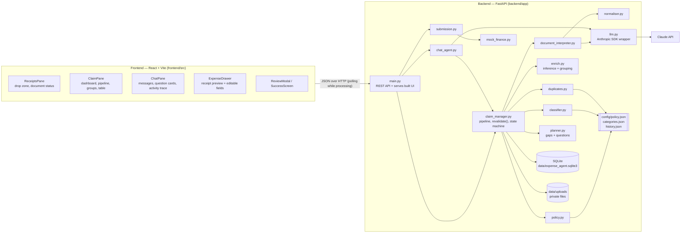
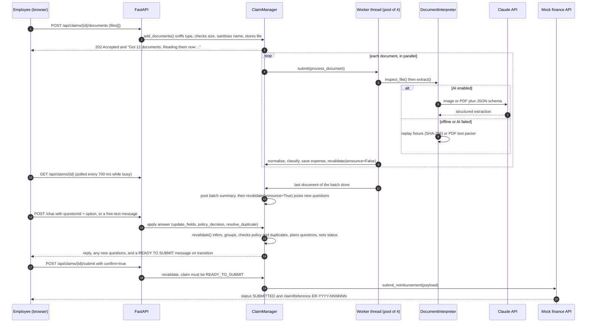
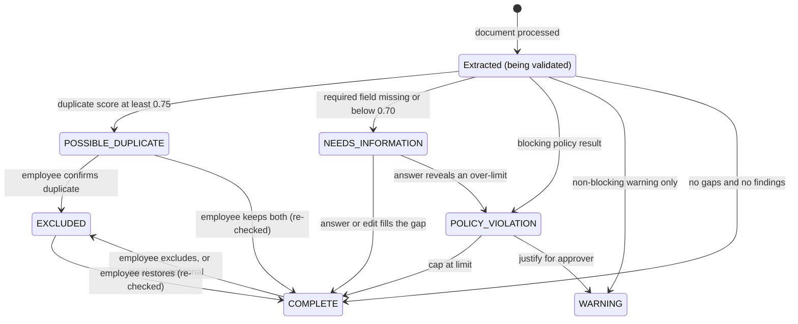
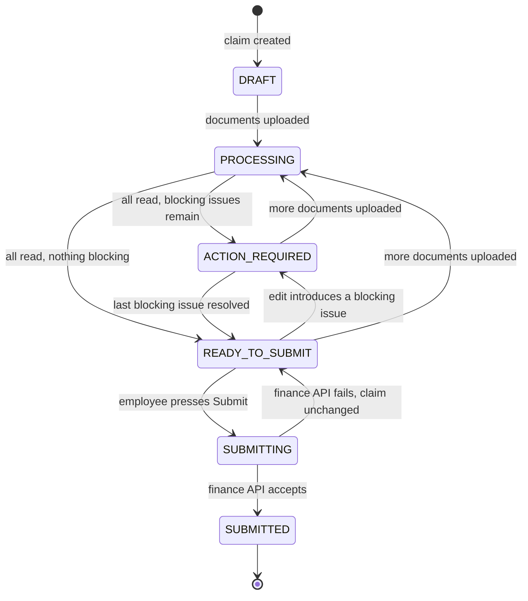
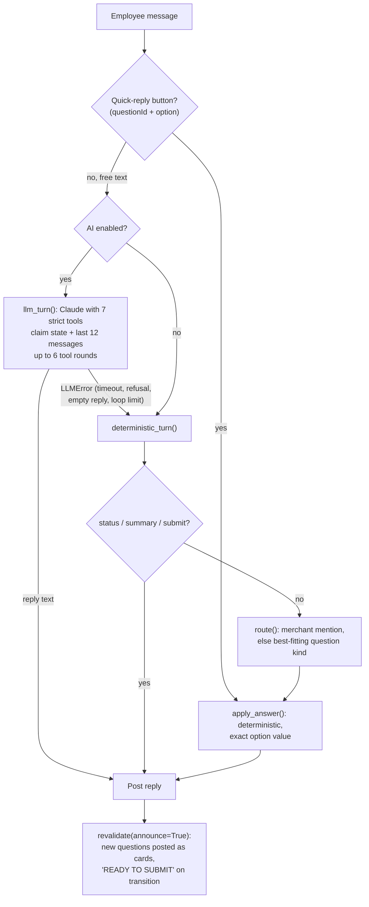

# Expense & Reimbursement Agent — Technical Design

**Track:** AI Innovation Lab Season 2 — business case: Expense & Reimbursement Agent

This document describes the system as it is implemented in this repository. Every threshold, weight and limit quoted here comes from the code or from `backend/config/*.json`. File references are relative to the repository root.

---

## 1. Project overview

### 1.1 Problem

Filing an expense claim is mostly data entry: retyping merchant, date, amount and GST from each receipt into a long form, then reading the policy to guess what finance will reject. Claims are rejected late for missing business purposes, over-limit hotels and duplicate receipts.

### 1.2 What the product does

The employee drops all their documents at once: phone photos, scans, PDFs and app screenshots. The agent turns them into a validated, policy-checked claim and asks **only** for the facts it cannot read or reasonably infer. Its tagline: *"Drop your receipts. Answer only what the AI couldn't determine. Submit."*

### 1.3 User journey

1. Create a claim (created automatically on first visit).
2. Upload one or many JPG/PNG/PDF files by drag-and-drop or file picker, or load the 12 bundled demo receipts.
3. Watch each document move through *Uploaded → Processing → Processed / Needs attention / Failed*.
4. Read the agent's batch summary, e.g. *"✓ 8 expenses are ready · ? 2 need information · ⚠ 1 exceeds policy · ⊘ 1 appears to be a duplicate … I only need 3 answers"*.
5. Answer each question with a one-tap quick reply or free text. The employee can also edit any expense directly in its detail drawer.
6. Every change re-validates the claim. Once no blocking issue remains, the claim becomes **READY_TO_SUBMIT**.
7. Review the structured summary, tick the confirmation box and press **Submit**.
8. The mock corporate API returns a reference (`ER-<year>-<6 digits>`). A final screen shows how much manual entry was avoided.

### 1.4 Key features

| Area | Implementation |
|---|---|
| Multi-format ingestion | JPG, PNG and PDF (multi-page). Type sniffed from magic bytes, size-limited, filenames sanitised |
| Field extraction with confidence | 28 field types, each extracted with a value, confidence and source (`backend/app/agent/fields.py`) |
| Categorisation | 15 policy categories, with confidence and a plain-language reason |
| Inference and grouping | Trip detection from flight/hotel bookings; business purpose inherited across a trip; nights, dates, city and currency derived |
| Policy engine | JSON-configured limits per item / event / night / day / month, required fields, date rules |
| Duplicate detection | Weighted signal scoring within the claim and against mock reimbursement history |
| Minimal questioning | Field-state model and a planner that consolidates questions and offers contextual quick replies |
| Conversational agent | Quick replies (deterministic) and free text (Claude tool use, with a deterministic fallback) |
| Human control | Edit, recategorise, exclude/restore, confirm or deny duplicates, cap or justify over-limit expenses, re-upload, explicit submit |
| Explainability | Per-expense "why the agent decided this" list, field source badges, agent activity trace |
| Mock submission | In-process mock finance API with payload validation and configurable failure injection |

### 1.5 Scope

Everything in the challenge's P0 list and most P1 items are implemented. Out of scope (P2): email ingestion, corporate-card reconciliation, calendar/itinerary integration, currency conversion, mileage, approver/finance agents and ERP integration. See [§5](#5-assumptions-and-limitations).

---

## 2. System architecture

### 2.1 Components



The frontend is built into `frontend/dist` and served by FastAPI, so production runs as one process on one port. In development, Vite serves the UI on `:5173` and proxies `/api` and `/mock-finance` to `:8000` (`frontend/vite.config.js`).

### 2.2 Upload → processing → revalidation → questions → submission



### 2.3 Expense state

`revalidate()` assigns statuses in this priority order (`backend/app/agent/claim_manager.py`): excluded → possible duplicate → missing information → blocking policy result → warning → complete.



Expense records are created only after a document has been read, so an expense never sits in `PROCESSING` in practice. Progress is shown at the **document** level instead: `UPLOADED → PROCESSING → PROCESSED | FAILED`. `NEEDS_ATTENTION` is derived when the expense needs information, violates policy or is a possible duplicate, and `DISMISSED` is set when the employee removes a failed document.

### 2.4 Claim state



`ACTION_REQUIRED` also applies when a claim has documents but no active expense, for example when everything is excluded. Once a claim is `SUBMITTED`, every mutating endpoint returns **409**.

### 2.5 Chat routing



The tools are `set_expense_fields`, `set_category`, `confirm_field`, `resolve_duplicate`, `resolve_over_limit`, `exclude_expense` and `rename_claim`. There is deliberately **no submit tool**.

---

## 3. Setup and deployment

### 3.1 Local setup

Prerequisites: Python 3.10+ and Node 18+.

```bash
./run.sh          # macOS / Linux
```
```powershell
.\run.ps1         # Windows PowerShell
```

Both scripts create `backend/.venv`, install `backend/requirements.txt`, build the frontend if `frontend/dist` is missing, copy `.env.example` to `.env` if absent, and start `uvicorn app.main:app` on `http://127.0.0.1:8000`.

For development, run the API and the UI separately:

```bash
cd backend && python -m venv .venv && .venv/bin/pip install -r requirements.txt
.venv/bin/python -m uvicorn app.main:app --reload --port 8000
cd ../frontend && npm install && npm run dev        # http://localhost:5173
```

On Windows, use `.venv\Scripts\python.exe` in place of `.venv/bin/python`.

### 3.2 Configuration (environment variables)

Read in `backend/app/settings.py`, optionally from `.env`, which is git-ignored.

| Variable | Default | Effect |
|---|---|---|
| `EXTRACTION_MODE` | `auto` | `auto`: Claude if credentials exist, else offline. `claude`: always Claude. `offline`: never call the API |
| `ANTHROPIC_API_KEY` | — | Read by the Anthropic SDK (`ANTHROPIC_AUTH_TOKEN` / `ANTHROPIC_PROFILE` also count as credentials) |
| `ANTHROPIC_MODEL` | `claude-opus-5-5` | Model for extraction and chat |
| `ANTHROPIC_EFFORT` | `low` | `output_config.effort` |
| `ANTHROPIC_TIMEOUT_SECONDS` | `90` | SDK timeout (the SDK also retries twice) |
| `ANTHROPIC_REFUSAL_FALLBACK` | `true` | Sends `fallbacks: "default"` with beta `server-side-fallback-2026-07-01` |
| `REFERENCE_DATE` | today | "Today" for the stale-date and future-date rules |
| `OFFLINE_PROCESSING_DELAY` | `0.9` | Simulated seconds per document offline (randomised between 0.7× and 1.3×) |
| `MAX_UPLOAD_MB` / `MAX_FILES_PER_UPLOAD` | `10` / `30` | Upload limits |
| `WORKER_THREADS` | `4` | Document-processing thread pool size |
| `DEMO_EMPLOYEE_ID` / `DEMO_EMPLOYEE_NAME` | `EMP001` / `Demo Employee` | The single demo identity |
| `MOCK_FINANCE_FAILURE_RATE` | `0` | Probability (0–1) that the mock finance API fails |
| `DATA_DIR`, `POLICY_CONFIG_DIR`, `DEMO_RECEIPTS_DIR`, `FRONTEND_DIST` | project paths | Storage and config locations |

### 3.3 Deployment

The application is a single process with no external services except the Claude API. A minimal production-like deployment:

* **Build:** run `npm ci && npm run build` in `frontend/`. FastAPI serves `frontend/dist` (the SPA catch-all in `main.py`) together with `/api` and `/mock-finance`.
* **Run:** `uvicorn app.main:app --app-dir backend --host 0.0.0.0 --port 8000 --workers 1`, either in a single container or on a VM behind a reverse proxy (nginx or Caddy) that terminates TLS. Set the proxy's `client_max_body_size` above `MAX_UPLOAD_MB × MAX_FILES_PER_UPLOAD`, or lower those limits.
* **Persistent volume:** mount `DATA_DIR` (default `./data`). It holds the SQLite database (`expense_agent.sqlite3`, WAL mode) and `uploads/`. Uploads are never served statically; they are reachable only through `GET /api/documents/{id}/file`.
* **Secrets:** provide `ANTHROPIC_API_KEY` as a secret (container secret, systemd `EnvironmentFile` with restricted permissions, or a cloud secret manager). Never bake it into an image or commit it.
* **Single-worker constraint:** run exactly **one** uvicorn worker. Document processing uses an in-process `ThreadPoolExecutor`, claim mutations are serialised by an in-process `RLock`, and SQLite is opened through one shared connection. Several workers would each have their own lock and pool and could race on the same claim. Scaling out needs the changes listed in the README's *Production considerations*: Postgres, a job queue and a distributed lock.

---

## 4. Code explanation

### 4.1 Module responsibilities

| Module | Responsibility |
|---|---|
| `backend/app/main.py` | REST endpoints, error mapping (`ClaimError` → HTTP status), file download with `nosniff`, SPA hosting |
| `backend/app/settings.py` | Environment configuration, `today()` (honours `REFERENCE_DATE`), `load_policy()`, which re-reads `policy.json` on every call |
| `backend/app/db.py` | SQLite persistence (JSON document per claim, document, expense, message, event and submission), counters, shared `RLock` |
| `backend/app/observability.py` | Structured stage events (`document_uploaded` … `claim_submitted`) logged as JSON lines and stored per claim for the activity trace. Only whitelisted keys (IDs, stage, status, confidence, counts) are kept |
| `agent/document_interpreter.py` | File inspection (magic bytes, PDF page count / encryption / corruption, image decode, EXIF orientation, min size 100×100 px, perceptual hash), Claude extraction with a JSON schema, offline replay and PDF-text parser |
| `agent/llm.py` | Anthropic client, request shape (model, effort, refusal fallback), mapping of SDK exceptions to `LLMError`, refusal / `max_tokens` / malformed-JSON handling |
| `agent/normaliser.py` | Type coercion of every AI value, card masking, multiple-totals and subtotal + tax plausibility checks, line items |
| `agent/classifier.py` | Combines the model's category suggestion with keyword/document-type evidence |
| `agent/enrich.py` | Derived fields, trip/month grouping, trip-purpose inheritance |
| `agent/policy.py` | Policy rules and limits, including period-limit attribution |
| `agent/duplicates.py` | Pairwise duplicate scoring within the claim and against history |
| `agent/planner.py` | Field states, gap detection, question planning and ordering |
| `agent/claim_manager.py` | Document lifecycle, `revalidate()`, statuses, employee actions, metrics, API snapshot |
| `agent/chat_agent.py` | Chat entry point, deterministic interpreter, Claude tool loop |
| `agent/submission.py` | Payload construction and the submit guard (`confirm: true`, `READY_TO_SUBMIT`) |
| `backend/app/mock_finance.py` | Mock corporate API: pydantic validation (`amount > 0`, `reimbursableAmount ≥ 0`, ≥ 1 expense), total check (±₹0.50), failure injection, reference generation |

### 4.2 Extraction and validation

* **Claude:** images are re-encoded as JPEG (quality 88, longest side ≤ 1800 px) and sent as an `image` block; PDFs are sent as a `document` block. The reply is constrained by `output_config.format` to a JSON schema. The schema has a `{value, confidence}` pair for each of the 27 extractable fields (all except `costCentre`), plus `documentType`, `readability`, `lineItems`, `categorySuggestion` (its enum is built from `policy.json` categories), `multipleTotalsFound` and `notes`. Values are strings, with `""` meaning absent, so the schema has no union types. `max_tokens` is 6000. A failed call is retried once, unless the request was rejected or declined, and then degrades to offline extraction. With `EXTRACTION_MODE=claude` it degrades to an empty, "needs attention" extraction instead.
* **Offline:** a file whose SHA-256 is in `demo_receipts/fixtures.json` gets its recorded extraction replayed (`extractionMode: "replay"`). Other PDFs with a text layer of at least 40 characters go through a regex parser with fixed confidences: merchant 0.72, invoice number 0.85, date 0.80, GSTIN 0.90, tax 0.75, currency 0.90, total 0.80 (0.60 when several different totals appear). Anything else becomes an empty extraction and the agent asks for the core fields.
* **Normaliser checks:** money, dates (years 2000–2100), integers and ISO currency codes are coerced. A value the model returned that cannot be parsed is dropped with a note. Card-number-like digit runs are masked to `XXXX-XXXX-XXXX-1234`, and `cardLast4` keeps only four digits. If the model reports `multipleTotalsFound`, the total's confidence is capped at **0.65**. If subtotal, tax and total are all known and subtotal + tax (+ service charge + tip) differs from the total by more than **max(₹2, 2% of total)**, the total's confidence is capped at **0.65**, with a reason and a note.

### 4.3 Classification

`classifier.py` scores every category in `config/categories.json`: **+5** for a matching document type, plus each keyword's weight found in the merchant, document type, line items, description and text. The rule-based confidence is `0.45 + 0.5 × share × strength`, where `share` is the best score divided by the total score and `strength = min(best / 8, 1)`. Combined with the model's suggestion:

| Case | Result |
|---|---|
| Model and rules agree | model category, confidence `min(0.99, max(model, rule) + 0.05)` |
| Rules disagree and are more than 0.15 more confident | rule category, confidence capped at **0.75**, reason mentions the disagreement |
| Rules disagree otherwise | model category, confidence capped at **0.80** |
| No model suggestion | rule category and rule confidence |
| No signal at all | `MISCELLANEOUS`, confidence **0.30** |

### 4.4 Confidence thresholds and field states

From `policy.json → confidenceThresholds`: **autoAccept = 0.90**, **review = 0.70**. `fields.field_state()` assigns:

| State | Rule |
|---|---|
| `KNOWN` | source `user`, or extracted with confidence ≥ 0.90 |
| `INFERRED` | extracted with 0.70 ≤ confidence < 0.90, or source `inferred` with confidence ≥ 0.70 |
| `LOW_CONFIDENCE` | any non-user value below 0.70 |
| `MISSING` | no value and the field is required |
| `NOT_REQUIRED` | no value and the field is not required |

A **gap** is a required field in `MISSING` or `LOW_CONFIDENCE`. Required fields are `general.alwaysRequired` (`merchant, expenseDate, total, currency`) plus the category's `requiredFields`. A category classified below 0.70 is also a gap (`category`). `INFERRED` values are accepted and shown with a dashed field and an "Inferred" badge, but never asked about.

### 4.5 Inference rules (`enrich.py`)

All inferred values are tagged `source: "inferred", derived: true` and recomputed from scratch on every revalidation, so correcting an upstream value (for example a date) flows through.

| Inference | Confidence | Condition |
|---|---|---|
| Currency = INR | 0.85 | No currency, and a GSTIN or ₹ on the document |
| Nights | 0.95 | From check-in/check-out, unless the user set it |
| Expense date = check-out | 0.85 | Hotel without a date |
| Expense date = travel date | 0.85 | Air/train without a date |
| Travel date = expense date | 0.75 | Air/train without a travel date |
| City | 0.90 | Recognised in the merchant address (or a hotel's destination) |
| Business purpose = trip purpose | 0.80 | Expense is in a trip group and its category has `inheritTripPurpose` |

**Trips** are anchored on air/train expenses (destination city plus travel/return dates) and hotels (city plus check-in/out). Anchors in the same city whose windows overlap within ±1 day are merged. An expense joins a trip when its date falls within the trip window, or when it has no date but its city or address matches. Recurring categories (`MOBILE_INTERNET`, `SOFTWARE_SUBSCRIPTION`, `FUEL`) never join a trip. Everything else is grouped by month. Employees can rename groups and move expenses between them (`groupNames`, `groupOverrides`).

**Trip purpose** comes from a non-meal expense in the trip. A user-entered purpose ranks above an extracted one with confidence ≥ 0.70. Inheritance is **blocked** for meals above `inheritPurposeMaxAmount` (**₹1,000**) or with more than `inheritPurposeMaxCovers` (**2**) covers, because such a bill could be client entertainment. The reason is shown to the employee.

### 4.6 Policy engine (`policy.py`, `config/policy.json`)

Per-expense rules:

| Code | Severity | Rule |
|---|---|---|
| `NON_POSITIVE` | violation | total ≤ 0 |
| `FUTURE_DATED` | violation | date after `today()` |
| `STALE` | warning | older than **60** days |
| `FOREIGN_CURRENCY` | warning | currency ≠ INR |
| `INVOICE_REQUIRED` | warning | category requires an invoice but no invoice or booking number was found |
| `RECOMMENDED_MISSING` | warning | e.g. taxi without origin/destination |
| `RECEIPT_UNREADABLE` | warning | readability `unreadable` and total above ₹300 |

Limits by `per`:

| `per` | Comparison |
|---|---|
| `item`, `event` | total vs limit |
| `night` | total vs limit × nights (nights default to 1) |
| `day`, `month` | all expenses of the category on that date or in that month, pooled |

Demo limits: Meals ₹1,500/day, Client Entertainment ₹5,000/event, Hotel ₹7,500/night, Taxi ₹3,000/day, Local Transport ₹1,000/day, Parking ₹500/day, Toll ₹1,000/day, Fuel ₹5,000/month, Mobile ₹1,500/month, Software ₹3,000/month, Office Supplies ₹5,000/item, Miscellaneous ₹2,000/item. Air, Train and Training have no limit.

**Period-limit attribution (`period_excess_shares`).** When a day or month bucket exceeds its limit, the expenses are added **smallest first** (ties broken by upload order) to a running total. Each expense is charged only the part of it that lies above the limit: `share = running_after − max(running_before, limit)`. The shares sum to `spent − limit`, no expense is charged more than its own amount, and small expenses that fit under the limit are not flagged; they get an informational `PERIOD_SHARED` result. Examples:

* ₹2,000 dinner + ₹100 coffee, ₹1,500/day: the coffee fits, so the dinner is charged ₹600.
* ₹900 + ₹1,000 + ₹1,100, ₹1,500/day: ₹900 fits; ₹1,000 brings the running total to ₹1,900 and is charged ₹400; ₹1,100 is charged ₹1,100.

**Over-limit decisions:** an unresolved over-limit is `OVER_LIMIT`, a blocking violation. The employee can:

* **cap** it (`OVER_LIMIT_CAPPED`, info): `reimbursableAmount = max(total − share, 0)`, also exposed as `cappedAmount`;
* **justify** it with text (`OVER_LIMIT_JUSTIFIED`, a non-blocking warning sent to the approver).

Changing an expense's category clears any previous decision, and changing its amount clears a cap. Warnings never block submission (`general.warningsBlockSubmission: false`).

### 4.7 Duplicate scoring (`duplicates.py`)

For each pair, the earlier upload is treated as the original and the later one as the suspect:

| Signal | Weight |
|---|---|
| Same file SHA-256 | score fixed at **0.99** |
| Same invoice number (normalised) | +0.40 |
| Same amount (±₹0.01) | +0.25 |
| Same date | +0.15 |
| Merchant similarity > 0.85 (difflib ratio) | +0.12 |
| Perceptual image hash similarity > 0.90 | +0.10 |
| Same origin and destination | +0.04 |

The score is capped at **0.98**, and a pair is flagged at **≥ 0.75** (`duplicateThreshold`). If nothing in the claim matches, the expense is compared with `config/history.json` (previously reimbursed expenses). Resolutions: `duplicate` excludes the expense; `separate` is stored per pair (or per history entry) and suppresses that pair on every later revalidation. The demo's two ZipCab receipts score 0.96: invoice number, amount, date, merchant and route.

### 4.8 Question planning (`planner.py`)

A question is generated only for a gap, meaning a required field that is missing or below 0.70 and not inferable, or for a decision. In order:

1. **trip_purpose**: one question per trip for every inheriting expense that lacks a purpose ("One answer covers all N trip expenses").
2. **meal_purpose**: for meals whose purpose couldn't be inherited. Options: Client meal / Team meal / Personal meal / Something else. "Client" recategorises the expense to Client Entertainment; "Personal" excludes it.
3. **attendees**: for Client Entertainment; purpose and attendees are asked together when both are missing.
4. **fields**: one consolidated question per expense for the remaining gaps. A single low-confidence value gets a "Yes, ₹X is correct" confirmation. A missing date inside a trip gets one chip per trip day (up to 5). A missing total invites a clearer upload.
5. **category**: shown when the category confidence is below 0.70. Options are the top-ranked categories, plus Miscellaneous.
6. **over_limit / justification**: deferred while the expense still has gaps, because the answer can change the category and its limit. The cap option shows the expense's own capped amount.
7. **duplicate**: a decision rather than a question; listed last.

Question IDs are stable (for example `meal_purpose:<expenseId>`), and each ID is posted to the chat only once (`askedQuestionIds`). An answered question disappears because its gap no longer exists, so the agent never re-asks something it already knows.

### 4.9 Chat interpretation (`chat_agent.py`)

* **Quick replies** carry an exact option value and are applied without interpretation.
* **Claude path:** the system prompt plus a JSON snapshot of the claim (active expenses with status, purpose, attendees, gaps, policy titles and duplicate link, plus the open questions) and the last 12 messages. Seven strict tools; after each round the updated claim state is fed back; at most 6 rounds. Any `LLMError` (including an empty reply or the round limit) falls back to the deterministic interpreter.
* **Deterministic path:** handles "status / summary / what's left" and "submit" (it points the employee to the Submit button), then `route()` picks a question. A merchant mentioned by name wins. Otherwise each open question is scored: duplicate vocabulary 3; cap/limit/justify vocabulary 3 (+0.5 for an open justification question); meal-type words 3 (generic meal words 1); "with <names>" 2.5 for attendees; a recognised category 3; trip/visit/meeting words 2 for trip purpose; a parsable date or amount 2.5 for a field question (0.3 otherwise). Ties go to the planner order. `parse_date` understands ISO dates, "23 Sep", "Sep 22", "22/9/26", "the 23rd" and weekday names resolved inside the trip window.

### 4.10 AI versus deterministic — and why

| Step | Approach | Reason |
|---|---|---|
| Reading documents | **AI** (Claude, multimodal, schema-constrained) | Real receipts are rotated, blurred, multi-page and inconsistent; rules can't read them |
| Category suggestion | **AI + rules** | The model understands context; configurable keyword evidence keeps it honest and lowers confidence on disagreement |
| Free-text answers | **AI** (tool use) with a deterministic fallback | Natural language with several answers in one message; the fallback keeps the demo and outages working |
| Validation, inference, grouping | Deterministic | Must be explainable, repeatable and correct by construction |
| Policy evaluation | Deterministic, configured in JSON | Finance rules must be auditable; the model must never decide money |
| Duplicate detection | Deterministic weighted scoring | Explainable signals and a tunable threshold |
| Question planning | Deterministic | The planner decides what to ask; it never invents questions |
| Submission | Deterministic, explicit employee action | No AI path can submit a claim |

The AI never writes authoritative financial values without going through validation: its output is type-checked, plausibility-checked and confidence-gated, and the employee confirms anything uncertain.

### 4.11 "Manual entry avoided" metric

`compute_metrics()` counts, over active expenses:

* **extracted:** fields with source `extracted`;
* **inferred:** fields with source `inferred`, plus one per automatically classified category;
* **manual:** fields with source `user`, plus categories the user set.

`manualEntryAvoidedPct = (extracted + inferred) / (extracted + inferred + manual)`. `questionsAsked` counts posted questions excluding duplicate decisions. In the demo run: 146 extracted, 19 inferred, 4 entered, 3 questions, **98%**.

---

## 5. Assumptions and limitations

* **Offline mode is replay, not OCR.** Without credentials the 12 demo receipts replay recorded extractions keyed by SHA-256. Other text PDFs use a conservative regex parser; other images ask the employee for the core fields. With an API key, every document is read live.
* **One expense per document.** A PDF containing several unrelated receipts becomes one expense.
* **No currency conversion.** Non-INR expenses get a `FOREIGN_CURRENCY` warning for finance.
* **Single demo employee, no authentication.** Document IDs are unguessable (`DOC-` + 12 URL-safe random characters) but not access-controlled.
* **Sequential claim IDs.** Claims are `CLM-1028`, `CLM-1029`, …; mock references are `ER-<current year>-001029`, … from a SQLite counter.
* **Mock history.** Cross-claim duplicate checks use the two entries in `config/history.json`.
* **In-process thread pool.** Processing runs in a 4-thread pool inside the web process. Work in flight is lost on restart, and the app must run as a single worker (§3.3).
* **Policy re-read on each evaluation.** Edits to `policy.json` take effect at the next revalidation without a restart, but claims are not versioned against a policy revision.
* **Reference date.** Stale and future rules use `REFERENCE_DATE` if set; the finance reference uses the real current year.
* **Trip purpose precedence.** A purpose typed for one non-meal expense in a trip outranks the purpose read from the booking and is inherited by the rest of the trip.

---

## 6. Testing strategy

Run from `backend/`:

```bash
.venv/bin/python -m pytest -q                  # Windows: .venv\Scripts\python.exe -m pytest -q
.venv/bin/python -m pytest -q --cov=app        # with coverage
.venv/bin/ruff check --select F,E9 app tests ../scripts
```

The suite has **81 tests**, with no network access. Tests run in offline mode against a temporary `DATA_DIR` with `REFERENCE_DATE=2026-10-07` and zero processing delay (`tests/conftest.py`). The Anthropic client is replaced with fakes wherever the Claude path is exercised.

| Suite | Covers |
|---|---|
| `test_demo_flow.py` | The full demo journey through the HTTP API (8/2/1/1 → READY_TO_SUBMIT → submit), blocking submission, team-meal violation and justification, personal exclusion, client-meal limit wording, rejected uploads |
| `test_units.py` | Formatting, card masking, normaliser rejection and plausibility, policy rules including period-limit attribution and cap clamping, duplicate scoring, date parsing, the offline PDF parser, image inspection, the Claude extraction path (mocked) |
| `test_llm.py` | Each SDK exception → `LLMError`; refusal, truncation, empty, malformed and non-object replies; request shape and the refusal-fallback flag |
| `test_planner_enrich.py` | Trip-purpose consolidation, meal vs attendees, category options, date chips, deferred policy questions, confirmation and upload prompts; inheritance and its blocks, derived fields, trip grouping, overrides |
| `test_chat_agent.py` | `route()` phrasings, parsing helpers, every answer kind, status/submit/frozen replies, the Claude tool loop (errors, rename, unknown tool) and its fallback on `LLMError` |
| `test_claims.py` | Status transitions, replace/dismiss documents, upload limits, group rename/override, edit validation, frozen submitted claims, history duplicates, persistence of `separate`, finance failure keeping the claim ready, mock API validation, payload preview |

**Coverage:** **95%** of `app/` statements (2,253 statements, 122 missed). Before this test pass it was 78%. Per module: `llm.py` 100%, `submission.py` 100%, `mock_finance.py` 100%, `chat_agent.py` 94%, `claim_manager.py` 95%, `document_interpreter.py` 91%.
